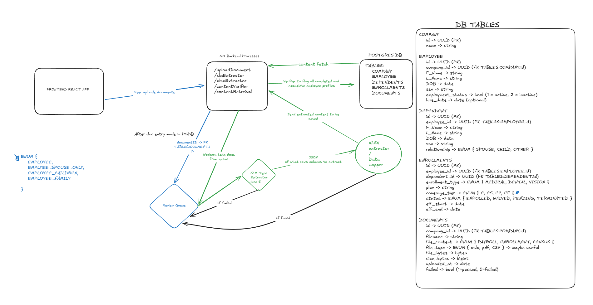

## Goals

Turn messy company census documents into one consistent set of employee, dependent, and benefit records. The first version will handle the supplied CSV examples, reconcile Company B's payroll and enrollment files, store the results, and export two formats. Missing or conflicting information should remain visible for review.

## Architecture

A basic web frontend lets users create companies (accounts), upload documents, review issues, and download exports (cleaned employee data). A Go backend handles uploads, processing, storage, and retrieval; I am picking go because I can run a bunch of lightweioght go processes. Postgres stores the original document bytes and metadata alongside the company, employee, dependent, and enrollment records. Extraction plans, source references, and review decisions will also be stored in Postgre.

A durable queue holds document IDs and workers can pull fropm that for the jobs. Workers load documents by ID and process them in the background. A failed attempt gets one retry. After a second failure, the worker sets the document's failed flag and leaves it for manual review. Results are committed before the job is acknowledged, and retries must not create duplicate records.

### DATABASE TABLES (PGDB)
    COMPANY
        id -> UUID (PK)
        name -> string

    EMPLOYEE
        id -> UUID (PK)
        company_id -> UUID (FK TABLES:COMPANY.id)
        F_Name -> string
        L_Name -> string
        DOB -> date
        ssn -> string
        employment_status -> bool (1 = active, 2 = inactive)
        hire_date -> date (optional)

    DEPENDENT
        id -> UUID (PK)
        employee_id -> UUID (FK TABLES:EMPLOYEE.id)
        F_Name -> string
        L_Name -> string
        DOB -> date
        ssn -> string
        relationship -> ENUM { SPOUSE, CHILD, OTHER }
        
    ENROLLMENTS
        id -> UUID (PK)
        employee_id -> UUID (FK TABLES:EMPLOYEE.id)
        dependent_id -> UUID (FK TABLES:DEPENDENT.id)
        enrollment_type -> ENUM { MEDICAL, DENTAL, VISION }
        plan -> string
        coverage_tier -> ENUM { E, ES, EC, EF }
        status -> ENUM { ENROLLED, WAIVED, PENDING, TERMINATED }
        eff_start -> date
        eff_end -> date

    DOCUMENTS
        id -> UUID (PK)
        company_id -> UUID (FK TABLES:COMPANY.id)
        filename -> string
        file_content -> ENUM { PAYROLL, ENROLLMENT, CENSUS }
        file_type -> ENUM { xslx, pdf, CSV } -> maybe useful
        file_bytes -> bytea
        size_bytes -> bigint
        uploaded_at -> date
        failed -> bool (1=passed, 0=failed)

### Backend Routes
    - /uploadDocments
    - /slmExtractor -> spawns go worker to read from queue and run the slmExtraction 
    - /xlsxExtraction -> called after the slm extraction takes output JSON from slmExtractor and document id, starts parsing the
                         document content writing it to local worker memory stored in ram
    - /contentVerifier -> takes the workers local memory and starts to parse it validating content and creating employee profiles to be
                          written to the DB; holds it in ram as it is processing new list before commiting list to db; Updates working memory of extraction worker. Taking in raw extracted content and appending complete and incopmlete profiles and eventually overwrites all teh raw working memory with the new filled out and missing information employee tables, they then
    - /storeData -> takes the working validated json from the extraction workers memory and writes them to the database tables
    - /contentRetreiver -> extracts companies information and employees/dependents and either displays them or fills them into a
                           predefined xml template for document/ppt rendering

## Extraction Pipeline

The backend parses each CSV into records and prepares headers, sample rows, notes, and footer context for the language model. The model receives the destination field definitions and returns a structured extraction plan describing the document type, relevant columns, row meanings, date conventions, and records to skip.

Basically, a worker will go to the queue and grab a document, that document gets added to the queue after the user unploads it, or if they upload moultiple files at once they all get put on there. The worker then takes the bytes, up to a certain amount (you dont need to feed the whole file to the slm only headers, tags, and a few rows). The worker then extracts those based on the defined system prompt. i was thinking gpt 6 luna, it is cheap to run, good at classification, and have built in structured output. The slm then returns a json object to a xlsx extractor to loop over until it extracts all the content it needs from the csv/xlsx (temporary storage in the go worker memory to audit before writing to DB). The worker then passes the working memory to some validation functions (SSN val, DOB val, NAME val) then creates employee records for employees who have all the information in the supplied docs. A list of employees missing information can be added and tracked and if no other documents for that company exist then supply that back to the users for review, if they do then process the next document and see if you can extract the necessary context from the employees table, then JOIN the two tables to see if you can get more whole employees, all whole employees will be exportd to the database, and then the remainiong get sent back to the user for more information.

## Export and Validation

Export from the reconciled database using fixed mappings for each destination. Start with an employee summary CSV and a member-per-benefit CSV, each with defined columns, date formats, and coverage codes. Check destination requirements before export and identify unresolved issues that affect the requested output.

Evaluate extraction, person matching, dependent links, and conflict detection against expected results from the original and synthetic examples. Keep evaluation answers out of model inputs. Include duplicate uploads, retries, missing fields, invalid dates, and the 1,200-employee dataset. Verify exported values and counts against the reconciled records, and confirm that repeating a job does not duplicate people or coverage.
